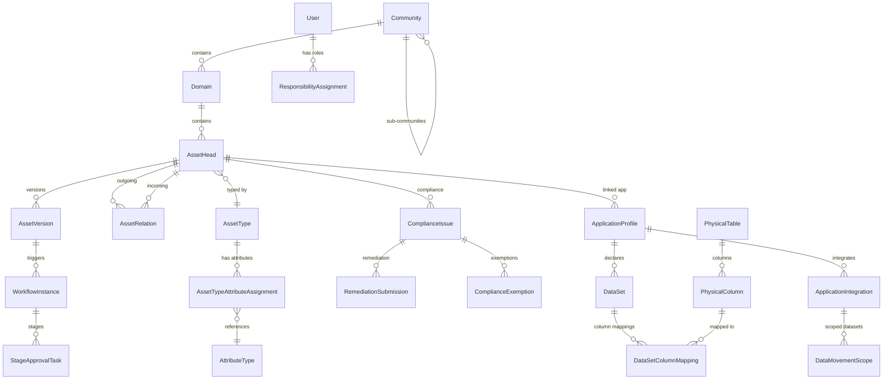

# AGENTS.MD — Enterprise Data Management Centre

> **Purpose:** This file gives any coding agent the full context needed to understand, modify, and extend this repository correctly. Read this before making any changes.

---

## 1. Project Overview

**Enterprise Data Management Centre** is a desktop-first enterprise data governance platform for organizational stewardship, metamodel extensibility, immutable asset versioning, and compliance accountability.

### Tech Stack

| Layer | Technology |
|---|---|
| **Frontend** | React 19 · TypeScript 6 · Vite 8 · Tailwind CSS v4 · Radix UI Themes · shadcn/ui (radix-mira) · TanStack Router v1 · TanStack Query v5 · Zustand 5 · cmdk |
| **Backend** | FastAPI · Python 3.12+ · SQLAlchemy 2.0 Async (Mapped/mapped_column) · Pydantic v2 · Alembic |
| **Database** | PostgreSQL 18 (Docker, `postgres:18-alpine`) · Native `uuidv7()` · `pg_trgm` GIN indexes |
| **Auth** | Stateless JWT (bcrypt password hashing, `python-jose`) · RACI personas |
| **API Client** | Auto-generated via `@hey-api/openapi-ts` with `@hey-api/client-fetch` + `@tanstack/react-query` plugin |
| **Linting** | OxLint (frontend) |
| **Testing** | pytest + pytest-asyncio (backend, `asyncio_mode = "auto"`) |
| **Package Managers** | uv / pip (backend) · npm (frontend) |

### RACI Personas

The platform models five governance roles. Seed accounts (password: `password123`):

| Role | Email | Description |
|---|---|---|
| `PLATFORM_ADMIN` | `admin@governance.com` | Full access, system config |
| `DATA_STEWARD` | `steward@governance.com` | Curates assets, runs verifications |
| `BUSINESS_OWNER` | `business.owner@governance.com` | Domain/community ownership |
| `APP_OWNER` | `app.owner@governance.com` | Application profile, data movement |
| `DATA_CONSUMER` | `consumer@governance.com` | Read access, search, consumption |

---

## 2. Repository Structure

```
data-governance-centre/
├── backend/
│   ├── alembic/
│   │   ├── versions/                  # Migration files (e.g. 1ebd0f931560_0001_initial_schema.py)
│   │   ├── env.py                     # Sync Alembic env (uses SYNC_SQLALCHEMY_DATABASE_URI)
│   │   └── script.py.mako
│   ├── app/
│   │   ├── api/
│   │   │   ├── deps.py                # Shared FastAPI dependencies (get_current_user, service factories)
│   │   │   └── v1/                    # All v1 route modules
│   │   │       ├── router.py          # Aggregates all sub-routers
│   │   │       ├── auth.py            # Login (email/password), /me, JWT
│   │   │       ├── assets.py          # Asset CRUD, draft lifecycle, diff, history, lineage
│   │   │       ├── communities.py     # Community CRUD
│   │   │       ├── domains.py         # Domain CRUD
│   │   │       ├── metamodel.py       # AssetType, AttributeType, assignments
│   │   │       ├── workflows.py       # Workflow instances, stage approval tasks
│   │   │       ├── compliance.py      # Compliance issues, remediation, exemptions
│   │   │       ├── verifications.py   # Verification runs and steward queue
│   │   │       ├── policies.py        # PolicyRule CRUD
│   │   │       ├── data_movement.py   # Application profiles, datasets, integrations
│   │   │       ├── workbench.py       # Workbench dashboard aggregation
│   │   │       ├── storage.py         # StorageControl CRUD
│   │   │       ├── schema_harvest.py  # Physical schema drift detection
│   │   │       └── privacy.py         # UsageEntitlement management
│   │   ├── core/
│   │   │   ├── config.py              # Settings via pydantic-settings (env vars, computed DB URIs)
│   │   │   ├── database.py            # Async engine + AsyncSessionLocal factory + get_db()
│   │   │   └── security.py            # JWT creation, bcrypt password hashing/verification
│   │   ├── domain/                    # Pure business logic (ZERO framework/DB imports)
│   │   │   ├── exceptions.py          # DomainException hierarchy
│   │   │   ├── entities/
│   │   │   │   ├── compliance.py      # Compliance scoring logic
│   │   │   │   ├── diff.py            # Version diff generation
│   │   │   │   └── workflow.py        # Workflow state machine
│   │   │   └── validation/
│   │   │       ├── __init__.py
│   │   │       └── attribute_validator.py  # Dynamic metamodel attribute validation
│   │   ├── models/                    # SQLAlchemy ORM models (Mapped[] style)
│   │   │   ├── __init__.py            # Re-exports all models + enums
│   │   │   ├── base.py               # Base, UUIDv7PKMixin, TimestampMixin
│   │   │   ├── user.py               # User
│   │   │   ├── organization.py       # Community (recursive), Domain, DomainTypeEnum
│   │   │   ├── metamodel.py          # AssetType, AttributeType, AssetTypeAttributeAssignment, RelationType
│   │   │   ├── asset.py              # AssetHead, AssetVersion, AssetRelation, VersionStatusEnum
│   │   │   ├── rbac.py               # GovernanceRole, ResponsibilityAssignment
│   │   │   ├── workflow.py           # WorkflowDefinition, WorkflowStage, WorkflowInstance, StageApprovalTask
│   │   │   ├── compliance.py         # ComplianceIssue, RemediationSubmission, ComplianceExemption
│   │   │   ├── policy_rule.py        # PolicyRule, PolicyRuleCategoryEnum, PolicyEnforcementModeEnum
│   │   │   ├── data_movement.py      # ApplicationProfile, DataSet, ApplicationIntegration, DataMovementScope
│   │   │   ├── physical_schema.py    # PhysicalTable, PhysicalColumn, DataSetColumnMapping, SchemaHarvestRun
│   │   │   ├── storage_control.py    # StorageControl
│   │   │   └── privacy_entitlement.py  # UsageEntitlement
│   │   ├── schemas/                   # Pydantic v2 request/response schemas
│   │   │   ├── user.py, asset.py, organization.py, metamodel.py
│   │   │   ├── workflow.py, compliance.py, data_movement.py, lineage.py
│   │   │   └── (each follows Create/Update/Read convention)
│   │   ├── services/                  # Business logic with DB access
│   │   │   ├── __init__.py            # Re-exports all service classes
│   │   │   ├── asset_service.py       # AssetService (draft lifecycle, lineage graph BFS)
│   │   │   ├── metamodel_service.py   # MetamodelService
│   │   │   ├── workflow_service.py    # WorkflowService
│   │   │   ├── compliance_service.py  # ComplianceService
│   │   │   ├── verification_service.py
│   │   │   ├── policy_engine_service.py
│   │   │   ├── data_movement_service.py
│   │   │   ├── workbench_service.py
│   │   │   ├── storage_service.py
│   │   │   ├── schema_harvest_service.py
│   │   │   ├── privacy_service.py
│   │   │   ├── seed_data.py           # Seeds users, metamodel, communities, domains, roles
│   │   │   └── seed_workbench.py      # Seeds workbench demo data
│   │   ├── __init__.py
│   │   └── main.py                    # FastAPI app, CORS, router mounting, health endpoint
│   ├── tests/
│   │   ├── conftest.py                # Fixtures: db_session, async_client (ASGI transport)
│   │   ├── unit/
│   │   │   └── test_attribute_validator.py
│   │   ├── test_auth_api.py
│   │   ├── test_catalog_api.py
│   │   ├── test_services_3tier.py
│   │   └── (more test files...)
│   ├── alembic.ini
│   ├── pyproject.toml
│   └── run.py                         # uvicorn runner
├── frontend/
│   ├── src/
│   │   ├── api/
│   │   │   ├── client.ts              # Typed API wrapper, auth interceptor, clean SDK exports
│   │   │   └── generated/             # ⚠️ AUTO-GENERATED — never edit manually
│   │   │       ├── sdk.gen.ts
│   │   │       ├── types.gen.ts
│   │   │       ├── @tanstack/react-query.gen.ts  # Generated TanStack Query hooks
│   │   │       └── client/ core/
│   │   ├── components/
│   │   │   ├── ui/                    # shadcn/ui primitives (add via CLI, don't hand-write)
│   │   │   ├── Header.tsx             # Top nav bar, persona switcher, Cmd+K trigger
│   │   │   ├── ThemeCustomizer.tsx     # Radix Themes customizer popover
│   │   │   └── index.ts              # Barrel export
│   │   ├── context/
│   │   │   └── PersonaContext.tsx      # Persona/auth/theme React context provider
│   │   ├── features/                  # Feature modules (each is a self-contained vertical slice)
│   │   │   ├── catalog/               # 3-pane catalog workspace
│   │   │   │   ├── components/        # CommunityTree, AssetDataGrid, InspectDrawer, ...
│   │   │   │   ├── pages/catalog-page/
│   │   │   │   ├── stores/catalog.store.ts
│   │   │   │   ├── types/index.ts
│   │   │   │   ├── index.ts           # PUBLIC barrel — only import from here
│   │   │   │   └── README.md
│   │   │   ├── data-movement/         # Data movement hub
│   │   │   ├── inbox/                 # Governance inbox (approval tasks, verifications)
│   │   │   ├── policies/              # Policy engine hub
│   │   │   ├── remediation/           # Compliance remediation hub
│   │   │   ├── search/                # Cmd+K command palette
│   │   │   └── workbench/             # Executive workbench dashboard
│   │   ├── hooks/                     # (currently empty — hooks go in feature modules or here)
│   │   ├── lib/
│   │   │   └── utils.ts               # cn() utility for Tailwind class merging
│   │   ├── routes/                    # Page-level route components
│   │   │   ├── root.tsx               # RootLayout: PersonaProvider → Radix Theme → Header + Outlet
│   │   │   ├── catalog.tsx, workbench.tsx, inbox.tsx, ...
│   │   │   └── (thin wrappers that render feature pages)
│   │   ├── stores/
│   │   │   └── theme.store.ts         # Radix theme customization Zustand store
│   │   ├── globals.css                # Tailwind v4 + Radix Themes CSS custom properties
│   │   ├── main.tsx                   # Entry: QueryClient → RouterProvider
│   │   └── router.tsx                 # Programmatic route tree (createRouter/createRoute)
│   ├── components.json               # shadcn/ui config (style: radix-mira)
│   ├── openapi-ts.config.ts          # API codegen config (input from backend /api/v1/openapi.json)
│   ├── .oxlintrc.json
│   ├── tsconfig.json / tsconfig.app.json / tsconfig.node.json
│   ├── vite.config.ts
│   └── package.json
├── docker/
│   └── init-db.sql                    # Enables pg_trgm extension
├── docker-compose.yml                 # PostgreSQL 18 service
├── .gitignore
└── README.md
```

---

## 3. Architecture & Design Patterns

### 3.1 Backend: 3-Tier Architecture

```
Router (api/v1/)  →  Service (services/)  →  Model (models/)
       ↕                    ↕                      ↕
  Schemas (schemas/)    Domain (domain/)     Database (core/)
       ↕
  Dependencies (api/deps.py)
```

**Key patterns:**

1. **Routers** (`app/api/v1/`) define HTTP endpoints. Each router module creates `router = APIRouter(prefix="...", tags=[...])`. Routers set their **own prefix and tags** (unlike some projects where these are set at mount time).

2. **Dependencies** (`app/api/deps.py`) contains shared FastAPI `Depends()` factories:
   - `get_current_user(token, db)` — JWT decoding → User lookup
   - `get_<service>_service(db)` — returns instantiated service (e.g., `get_asset_service`)

3. **Services** (`app/services/`) contain all business logic. Each takes `AsyncSession` in `__init__`. Services raise domain exceptions from `app.domain.exceptions`, not `HTTPException`.

4. **Domain** (`app/domain/`) contains pure business logic with **zero framework/DB imports**:
   - `exceptions.py` — Exception hierarchy: `DomainException` → `EntityNotFoundException`, `ConcurrencyLockException`, `ValidationException`, `WorkflowExecutionException`, etc.
   - `entities/` — Diff engine, compliance scoring, workflow state machine
   - `validation/` — Dynamic metamodel attribute validator

5. **Models** (`app/models/`) use SQLAlchemy 2.0 **declarative Mapped style** (`Mapped[]`, `mapped_column()`). All models inherit from `Base` (DeclarativeBase). Most also use `TimestampMixin` and/or `UUIDv7PKMixin`.

6. **Schemas** (`app/schemas/`) are Pydantic v2 models following `Create` / `Update` / `Read` naming.

### 3.2 Frontend: Feature-Sliced Architecture

```
Route (routes/)  →  Feature Page (features/*/pages/)  →  Feature Components
                           ↕                                      ↕
              Feature Store (Zustand)                   API Client (api/client.ts)
                                                              ↕
                                                   Generated SDK (api/generated/)
```

**Key patterns:**

1. **Feature modules** (`src/features/`) are self-contained vertical slices with their own components, pages, stores, types, and API adapters. Each feature has:
   - `index.ts` — **Public barrel export** (the ONLY import point for other modules)
   - `components/` — Feature-specific UI components
   - `pages/` — Page-level components with their own `styles.ts` co-located
   - `stores/` — Zustand stores for client/UI state
   - `types/` — TypeScript interfaces
   - `api/` — Feature-specific API adapters (when needed beyond generated SDK)
   - `README.md` — Module ownership documentation

2. **Routing** uses TanStack Router v1 with **programmatic route definitions** in `router.tsx` (NOT file-based routing). Routes are defined via `createRootRoute` / `createRoute` / `createRouter`.

3. **State management** is split:
   - **Server state** → TanStack Query v5 (queryOptions from generated SDK, never mirrored to stores)
   - **Client/UI state** → Zustand stores (modal open states, drawer tabs, search state)
   - **Global context** → React Context for `PersonaContext` (auth, dark mode, command palette state)

4. **API client** (`src/api/client.ts`) wraps the generated SDK with clean aliases and an auth interceptor that reads JWT from `localStorage` key `"dgc_auth_token"`.

5. **UI system** layers Radix UI Themes (global theming) + shadcn/ui primitives (component-level) + Tailwind CSS v4 utilities + CSS custom properties.

### 3.3 Asset Versioning System (Head/Version Decoupling)

The core architectural pattern:

- **AssetHead** = persistent logical identity (pointer to published + draft versions, concurrency lock)
- **AssetVersion** = immutable version iteration (name, description, JSONB attributes, relations snapshot)
- **Lifecycle:** `DRAFT → UNDER_REVIEW → PUBLISHED → SUPERSEDED`
- **Concurrency:** Exclusive lease locks (`locked_by_user_id`, `locked_at`) with 5-minute default timeout

Flow: Create → Draft v1 → Publish → Fork Draft v2 → Edit → Publish (v1 becomes SUPERSEDED)

### 3.4 Organizational Hierarchy

```
Community (recursive self-referencing)
  └── Domain (scoped container with DomainType: GLOSSARY, DATA_PRODUCT, POLICY, SYSTEMS_REGISTER, METRIC_STORE)
       └── AssetHead (typed by metamodel AssetType)
            └── AssetVersion (immutable iterations)
```

---

## 4. How to Add a New Feature (End-to-End Checklist)

### 4.1 Backend

#### Step 1: Model (`backend/app/models/`)

```python
import enum
import uuid
from datetime import datetime
from typing import Optional
from sqlalchemy import DateTime, Enum as SQLEnum, ForeignKey, String, Text, func
from sqlalchemy.dialects.postgresql import UUID
from sqlalchemy.orm import Mapped, mapped_column, relationship
from app.models.base import Base, TimestampMixin


class MyStatusEnum(str, enum.Enum):
    ACTIVE = "ACTIVE"
    INACTIVE = "INACTIVE"


class MyEntity(Base, TimestampMixin):
    """Docstring explaining the entity's purpose."""
    __tablename__ = "my_entities"

    id: Mapped[uuid.UUID] = mapped_column(
        UUID(as_uuid=True),
        primary_key=True,
        default=uuid.uuid7,
        server_default=func.uuidv7()
    )
    name: Mapped[str] = mapped_column(String(255), nullable=False)
    description: Mapped[Optional[str]] = mapped_column(Text, nullable=True)
    status: Mapped[MyStatusEnum] = mapped_column(
        SQLEnum(MyStatusEnum, name="my_status_enum"),
        default=MyStatusEnum.ACTIVE,
        nullable=False
    )
```

**Model conventions:**
- Inherit from `Base` + `TimestampMixin` (gives `created_at`, `updated_at`)
- PK: `Mapped[uuid.UUID]` with `default=uuid.uuid7, server_default=func.uuidv7()` (Python 3.14 + PostgreSQL 18 native)
- Use `Mapped[]` and `mapped_column()` (SQLAlchemy 2.0 declarative), NEVER legacy `Column()`
- Table names: **plural snake_case** (`my_entities`)
- Enums: `class MyEnum(str, enum.Enum)` with `SQLEnum(MyEnum, name="my_enum_name")`
- FKs: `ForeignKey("table_name.id", ondelete="CASCADE"|"RESTRICT"|"SET NULL")`
- Use `TYPE_CHECKING` guard for relationship type hints to avoid circular imports
- Register in `backend/app/models/__init__.py` (import + add to `__all__`)

#### Step 2: Schema (`backend/app/schemas/`)

```python
from datetime import datetime
from typing import Optional
from uuid import UUID
from pydantic import BaseModel, ConfigDict


class MyEntityCreate(BaseModel):
    name: str
    description: Optional[str] = None

class MyEntityUpdate(BaseModel):
    name: Optional[str] = None
    description: Optional[str] = None

class MyEntityRead(BaseModel):
    id: UUID
    name: str
    description: Optional[str]
    status: str
    created_at: datetime
    updated_at: datetime
    model_config = ConfigDict(from_attributes=True)
```

**Schema conventions:**
- `Create` — required fields for creation
- `Update` — all fields optional (`Optional`)
- `Read` — full representation with `model_config = ConfigDict(from_attributes=True)`

#### Step 3: Domain Exception (if needed)

Add to `backend/app/domain/exceptions.py`:

```python
class MySpecificException(DomainException):
    """Raised when..."""
    pass
```

**Rule:** Domain exceptions have ZERO framework imports. No `HTTPException`, no SQLAlchemy.

#### Step 4: Service (`backend/app/services/`)

```python
from typing import List, Optional
import uuid
from sqlalchemy import select
from sqlalchemy.ext.asyncio import AsyncSession
from app.domain.exceptions import EntityNotFoundException
from app.models.my_entity import MyEntity
from app.schemas.my_entity import MyEntityCreate, MyEntityUpdate


class MyEntityService:
    """Cohesive business logic service for my entities."""

    def __init__(self, db: AsyncSession):
        self.db = db

    async def list_items(self) -> List[MyEntity]:
        result = await self.db.execute(
            select(MyEntity).order_by(MyEntity.created_at.desc())
        )
        return list(result.scalars().all())

    async def get_item(self, item_id: uuid.UUID) -> MyEntity:
        result = await self.db.execute(
            select(MyEntity).where(MyEntity.id == item_id)
        )
        item = result.scalar_one_or_none()
        if not item:
            raise EntityNotFoundException(f"MyEntity '{item_id}' not found.")
        return item

    async def create_item(self, data: MyEntityCreate, user_id: uuid.UUID) -> MyEntity:
        item = MyEntity(id=uuid.uuid7(), **data.model_dump())
        self.db.add(item)
        await self.db.commit()
        await self.db.refresh(item)
        return item

    async def update_item(self, item_id: uuid.UUID, data: MyEntityUpdate) -> MyEntity:
        item = await self.get_item(item_id)
        for field, value in data.model_dump(exclude_unset=True).items():
            setattr(item, field, value)
        await self.db.commit()
        await self.db.refresh(item)
        return item
```

**Service conventions:**
- Constructor takes `AsyncSession`, no other dependencies
- All methods are `async`
- Use `select()` (SQLAlchemy 2.0 style), NEVER legacy `session.query()`
- Use `scalars().all()` for lists, `scalar_one_or_none()` for single items
- Raise **domain exceptions** (`EntityNotFoundException`), NOT `HTTPException`
- Explicitly call `uuid.uuid7()` for new entity IDs
- Register in `backend/app/services/__init__.py`

#### Step 5: Dependency Factory (`backend/app/api/deps.py`)

```python
from app.services.my_entity_service import MyEntityService

def get_my_entity_service(
    db: Annotated[AsyncSession, Depends(get_db)]
) -> MyEntityService:
    """Dependency providing MyEntityService."""
    return MyEntityService(db)
```

#### Step 6: Router (`backend/app/api/v1/`)

```python
from fastapi import APIRouter, Depends, HTTPException
from typing import Annotated
from app.api.deps import get_current_user, get_my_entity_service
from app.models.user import User
from app.services.my_entity_service import MyEntityService
from app.schemas.my_entity import MyEntityCreate, MyEntityRead
from app.domain.exceptions import EntityNotFoundException

router = APIRouter(prefix="/my-entities", tags=["My Entities"])


@router.get("/", response_model=list[MyEntityRead])
async def list_items(
    service: Annotated[MyEntityService, Depends(get_my_entity_service)],
):
    return await service.list_items()


@router.post("/", response_model=MyEntityRead, status_code=201)
async def create_item(
    data: MyEntityCreate,
    service: Annotated[MyEntityService, Depends(get_my_entity_service)],
    current_user: Annotated[User, Depends(get_current_user)],
):
    return await service.create_item(data, current_user.id)


@router.get("/{item_id}", response_model=MyEntityRead)
async def get_item(
    item_id: str,
    service: Annotated[MyEntityService, Depends(get_my_entity_service)],
):
    try:
        return await service.get_item(item_id)
    except EntityNotFoundException as e:
        raise HTTPException(status_code=404, detail=e.message)
```

**Router conventions:**
- `router = APIRouter(prefix="/kebab-case", tags=["Human Readable"])` — prefix and tags set HERE
- Use `Annotated[ServiceClass, Depends(get_service)]` for service injection
- Use `Annotated[User, Depends(get_current_user)]` for auth
- Catch domain exceptions and convert to `HTTPException` at the router level
- Return `status_code=201` for creation endpoints
- Use `response_model` on every endpoint

#### Step 7: Mount in Router Aggregator

In `backend/app/api/v1/router.py`:

```python
from app.api.v1 import my_entity
api_router.include_router(my_entity.router)
```

(No prefix/tags needed here — they're on the sub-router itself.)

#### Step 8: Migration

```bash
cd backend
alembic revision --autogenerate -m "add my_entities table"
alembic upgrade head
```

**Note:** Alembic uses the **synchronous** driver (`psycopg2`) via `SYNC_SQLALCHEMY_DATABASE_URI`. Always review autogenerated migrations before applying.

#### Step 9: Tests

```python
import pytest
from httpx import AsyncClient


@pytest.mark.asyncio
async def test_list_my_entities(async_client: AsyncClient):
    resp = await async_client.get("/api/v1/my-entities/")
    assert resp.status_code == 200


@pytest.mark.asyncio
async def test_create_my_entity(async_client: AsyncClient):
    # Login first (auth is NOT mocked — tests hit real seeded data)
    login_resp = await async_client.post(
        "/api/v1/auth/login",
        json={"email": "steward@governance.com", "password": "password123"}
    )
    token = login_resp.json()["access_token"]
    headers = {"Authorization": f"Bearer {token}"}

    resp = await async_client.post(
        "/api/v1/my-entities/",
        json={"name": "Test Entity"},
        headers=headers,
    )
    assert resp.status_code == 201
```

**Test conventions:**
- All tests are `async def` — `asyncio_mode = "auto"` in `pyproject.toml`
- `async_client` fixture uses `httpx.AsyncClient` with `ASGITransport(app=app)`
- `db_session` fixture provides a real PostgreSQL async session (NOT in-memory SQLite)
- Auth is NOT mocked — tests log in via `/api/v1/auth/login` with seeded accounts
- Run: `cd backend && pytest -v`

---

### 4.2 Frontend

#### Step 1: Regenerate the API Client

After backend changes, regenerate the typed client (backend must be running):

```bash
cd frontend
npm run codegen
```

This updates `src/api/generated/`. **NEVER edit these files manually.**

If you added a new endpoint, also update `src/api/client.ts` to add clean wrapper methods and type aliases.

#### Step 2: Create a Feature Module (`src/features/my-feature/`)

```
features/my-feature/
├── components/
│   └── MyComponent.tsx
├── pages/
│   └── my-feature-page/
│       ├── my-feature-page.tsx
│       ├── my-feature-page.styles.ts   # Co-located styled CSS-in-TS (Tailwind class strings)
│       ├── index.ts                     # Re-export
│       └── README.md                    # Optional ownership doc
├── stores/
│   └── my-feature.store.ts              # Zustand UI state store
├── types/
│   └── index.ts
├── api/                                 # Optional: feature-specific API helpers
│   └── myFeatureApi.ts
├── index.ts                             # PUBLIC BARREL — only export point
└── README.md                            # Module ownership documentation
```

#### Step 3: Feature Barrel (`index.ts`)

```typescript
/**
 * Public contract for MyFeature module.
 * Other modules MUST only import through this barrel.
 */
export { MyFeaturePage } from "./pages/my-feature-page";
export { MyComponent } from "./components/MyComponent";
export { useMyFeatureUiStore } from "./stores/my-feature.store";
export type { IMyFeatureUiState } from "./stores/my-feature.store";
```

**CRITICAL RULE:** Never import internal paths like `@/features/my-feature/components/MyComponent`. Always import from `@/features/my-feature`.

#### Step 4: Zustand Store

```typescript
import { create } from "zustand";

export interface IMyFeatureUiState {
  isModalOpen: boolean;
  setModalOpen: (open: boolean) => void;
  reset: () => void;
}

const INITIAL_STATE = {
  isModalOpen: false,
} as const;

export const useMyFeatureUiStore = create<IMyFeatureUiState>()((set) => ({
  ...INITIAL_STATE,
  setModalOpen: (open) => set({ isModalOpen: open }),
  reset: () => set({ ...INITIAL_STATE }),
}));
```

**Store conventions:**
- Zustand v5 with TypeScript
- `create<InterfaceType>()(...)` pattern (double-invocation)
- Define `INITIAL_STATE` const and `reset()` method
- Interface name: `I<Feature>UiState` (prefixed with `I`)
- Export name: `use<Feature>UiStore`

#### Step 5: Page Component

```tsx
import React from "react";
import { useQuery } from "@tanstack/react-query";
// Import from generated query options
import { listMyEntitiesOptions } from "@/api/client";

export const MyFeaturePage: React.FC = () => {
  const { data: items = [], isLoading } = useQuery(listMyEntitiesOptions());

  return (
    <div className="flex flex-1 overflow-hidden">
      {/* ... */}
    </div>
  );
};
```

#### Step 6: Add Route

In `src/router.tsx`:

```typescript
import { MyFeaturePage } from "./routes/my-feature";

const myFeatureRoute = createRoute({
  getParentRoute: () => rootRoute,
  path: "/my-feature",
  component: MyFeaturePage,
});

// Add to routeTree:
const routeTree = rootRoute.addChildren([
  // ...existing routes,
  myFeatureRoute,
]);
```

Then create `src/routes/my-feature.tsx` as a thin wrapper:

```tsx
import { MyFeaturePage as Page } from "@/features/my-feature";
export const MyFeaturePage = Page;
```

#### Step 7: Add Navigation

In `src/components/Header.tsx`, add a `<Link>`:

```tsx
<Link to="/my-feature" className="flex items-center space-x-1 px-2.5 py-1 text-xs font-medium rounded-md transition-colors text-muted-foreground hover:text-foreground hover:bg-muted/50 [&.active]:bg-primary/10 [&.active]:text-primary [&.active]:font-semibold">
  <MyIcon className="w-3.5 h-3.5" />
  <span>My Feature</span>
</Link>
```

---

## 5. Key Conventions & Rules

### 5.1 Files You Must NEVER Edit Manually

| File/Directory | Reason |
|---|---|
| `frontend/src/api/generated/` | Auto-generated by `@hey-api/openapi-ts`. Run `npm run codegen`. |
| `frontend/src/components/ui/` | Managed by shadcn CLI. Add via `npx shadcn@latest add <name>`. |

### 5.2 Backend Conventions

| Rule | Detail |
|---|---|
| **Python version** | 3.12+ required (codebase uses `uuid.uuid7` from Python 3.14 stdlib) |
| **Async everywhere** | All route handlers, services, and DB operations are `async` |
| **UUIDv7 PKs** | `default=uuid.uuid7, server_default=func.uuidv7()` (Python + PostgreSQL 18 native) |
| **ORM style** | SQLAlchemy 2.0 declarative: `Mapped[]` + `mapped_column()` exclusively |
| **SQL style** | `select()` only, NEVER legacy `session.query()` |
| **Naming** | Files: `snake_case.py` · Classes: `PascalCase` · Functions/vars: `snake_case` · Enums: `UPPER_CASE` members |
| **Schema convention** | `EntityCreate`, `EntityUpdate`, `EntityRead` with `ConfigDict(from_attributes=True)` |
| **Service pattern** | `__init__(self, db: AsyncSession)` · Raise domain exceptions, not HTTPException |
| **Router pattern** | `APIRouter(prefix="/kebab-case", tags=["..."])` · Inject services via `Depends(get_service)` |
| **Dependency injection** | `Annotated[Type, Depends(factory)]` syntax (modern FastAPI style) |
| **Exception flow** | Domain → `DomainException` · Router catches and converts to `HTTPException` |
| **Config** | All via env vars through `pydantic-settings` in `core/config.py` |
| **Imports** | Absolute from `app.` (e.g., `from app.models.user import User`) |
| **API versioning** | All endpoints under `/api/v1/` prefix |
| **Windows compat** | `asyncio.WindowsSelectorEventLoopPolicy()` set in `main.py`, `database.py`, `conftest.py` |

### 5.3 Frontend Conventions

| Rule | Detail |
|---|---|
| **Path alias** | `@/*` maps to `src/*`. Always use `@/` imports. |
| **Feature module imports** | ONLY import from feature barrel (`@/features/catalog`), never internal paths |
| **File naming** | Components: `PascalCase.tsx` · Stores: `kebab-case.store.ts` · Styles: `kebab-case.styles.ts` |
| **Component naming** | `PascalCase` function components with `React.FC` typing |
| **Interface naming** | Prefix with `I` (e.g., `IHeaderProps`, `ICatalogUiState`) |
| **Data fetching** | TanStack Query v5 with generated `queryOptions` from `@tanstack/react-query.gen.ts` |
| **UI state** | Zustand stores for client-only state. Never mirror server data to Zustand. |
| **Global state** | `PersonaContext` for auth/persona, `useThemeStore` for Radix theme customization |
| **Styling** | Tailwind CSS v4 utilities + Radix Themes CSS variables. Dark mode via `.dark` class. |
| **Component library** | Radix UI Themes for global theming + shadcn/ui primitives (style: `radix-mira`) |
| **Icons** | `lucide-react` exclusively |
| **Toasts** | (Not yet configured — add `sonner` if needed) |
| **Forms** | Controlled inputs with `useState`. Use `zod` for validation when needed. |
| **API client** | `src/api/client.ts` wraps generated SDK. Auth token in `localStorage` key `"dgc_auth_token"`. |
| **API base URL** | Hardcoded to `http://localhost:8000` in `client.ts`. No Vite proxy configured. |

### 5.4 Database Conventions

| Rule | Detail |
|---|---|
| **Primary keys** | UUIDv7 via `uuid.uuid7()` (Python) + `func.uuidv7()` (PostgreSQL 18 native) |
| **Table names** | Plural snake_case (`asset_heads`, `workflow_instances`) |
| **Enum columns** | `SQLEnum(MyEnum, name="my_enum_name")` with string-backed Python enum |
| **JSON columns** | Use `JSONB` from `sqlalchemy.dialects.postgresql` |
| **Timestamps** | `TimestampMixin` gives `created_at` + `updated_at` on every table |
| **Trigram indexes** | Use `postgresql_using="gin", postgresql_ops={"col": "gin_trgm_ops"}` for search columns |
| **Migrations** | Alembic with synchronous driver (`psycopg2`). Revision messages are descriptive. |
| **DB name** | `governance_center` · User: `postgres` · Password: `postgres` |

---

## 6. Environment & Configuration

### Backend (`backend/.env` or environment variables)

```env
POSTGRES_SERVER=localhost
POSTGRES_PORT=5432
POSTGRES_USER=postgres
POSTGRES_PASSWORD=postgres
POSTGRES_DB=governance_center
POSTGRES_ASYNC_DRIVER=psycopg          # psycopg for cross-platform; asyncpg on Linux
POSTGRES_SYNC_DRIVER=psycopg2          # Used by Alembic migrations
SECRET_KEY=enterprise_data_governance_center_super_secret_key_change_in_production
ALGORITHM=HS256
ACCESS_TOKEN_EXPIRE_MINUTES=1440       # 24 hours
```

The `SQLALCHEMY_DATABASE_URI` and `SYNC_SQLALCHEMY_DATABASE_URI` are computed properties in `config.py` — do not set them directly.

---

## 7. Running the Application

```bash
# 1. Database
docker compose up -d db

# 2. Backend
cd backend
uv venv                                  # or: python -m venv .venv
uv pip install -e .                      # or: pip install -e .
.venv\Scripts\alembic upgrade head       # Apply migrations
.venv\Scripts\python -m app.services.seed_data  # Seed roles, personas, metamodel
.venv\Scripts\pytest -v                  # Run tests
.venv\Scripts\uvicorn app.main:app --reload --port 8000  # → http://localhost:8000

# 3. Frontend
cd frontend
npm install
npm run codegen                          # Requires backend running at :8000
npm run dev                              # → http://localhost:5173
```

### Running Tests

```bash
cd backend
pytest -v                                # All tests
pytest tests/test_catalog_api.py         # Specific file
pytest -k "test_create"                  # Pattern match
pytest tests/unit/                       # Unit tests only
```

### Linting

```bash
cd frontend
npm run lint                             # Runs oxlint
```

---

## 8. API Endpoint Reference

All endpoints are under `/api/v1/`. Most require JWT auth via `Authorization: Bearer <token>`.

| Method | Path | Description |
|---|---|---|
| **Auth** | | |
| `POST` | `/auth/login` | Email/password login → JWT |
| `GET` | `/auth/me` | Current user info |
| **Organization** | | |
| `GET/POST` | `/communities` | List / Create communities |
| `GET/POST` | `/domains` | List / Create domains |
| **Metamodel** | | |
| `GET` | `/metamodel/asset-types` | List asset types |
| `GET` | `/metamodel/attribute-types` | List attribute types |
| **Assets** | | |
| `GET/POST` | `/assets` | List (with search/filter) / Create asset head + initial draft |
| `GET` | `/assets/{id}` | Get asset head with versions |
| `POST` | `/assets/{id}/draft` | Acquire or fork draft (with concurrency lease) |
| `PUT` | `/assets/{id}/draft` | Update active draft |
| `POST` | `/assets/{id}/draft/release-lock` | Release editing lease |
| `POST` | `/assets/{id}/publish` | Promote draft to published |
| `GET` | `/assets/{id}/diff` | Visual diff between draft and published |
| `GET` | `/assets/{id}/history` | Version history ledger |
| `GET` | `/assets/{id}/lineage` | Multi-hop lineage graph DAG |
| **Workflows** | | |
| `GET` | `/workflows/tasks` | List approval tasks (filterable by role/status) |
| `POST` | `/workflows/tasks/{id}/action` | Approve/reject a task |
| **Compliance** | | |
| `GET/POST` | `/compliance/issues` | List / Create compliance issues |
| `POST` | `/compliance/issues/{id}/remediate` | Submit remediation |
| `POST` | `/compliance/issues/{id}/exempt` | Request exemption |
| **Verifications** | | |
| `GET` | `/verifications/pending` | Steward verification queue |
| `POST` | `/verifications/{id}/verify` | Verify a pending item |
| **Policies** | | |
| `GET/POST` | `/policies` | List / Create policy rules |
| **Data Movement** | | |
| `GET` | `/applications` | List application profiles |
| `GET/POST` | `/applications/{id}/datasets` | List / Create datasets |
| `GET/POST` | `/applications/{id}/integrations` | List integrations |
| **Storage** | | |
| `GET/POST` | `/storage` | List / Create storage controls |
| **Schema Harvest** | | |
| `POST` | `/schema-harvest/run` | Trigger schema drift detection |
| **Privacy** | | |
| `GET/POST` | `/privacy/entitlements` | List / Create usage entitlements |

---

## 9. Data Model Overview



---

## 10. Common Gotchas & Tips

1. **PostgreSQL 18 native `uuidv7()`** — This codebase uses native UUIDv7 from both Python 3.14 (`uuid.uuid7()`) and PostgreSQL 18 (`func.uuidv7()`). Do NOT add `uuid-ossp` or `pgcrypto` for UUID generation.

2. **Two database drivers** — The app uses `psycopg` (async) for runtime and `psycopg2` (sync) for Alembic migrations. Both must be installed. The driver is configurable via `POSTGRES_ASYNC_DRIVER` and `POSTGRES_SYNC_DRIVER` env vars.

3. **Windows event loop policy** — `asyncio.WindowsSelectorEventLoopPolicy()` is set in `main.py`, `database.py`, and `conftest.py`. Always include this guard when adding new async entry points on Windows.

4. **Domain exceptions, NOT HTTPException** — Services raise domain exceptions from `app.domain.exceptions`. Routers catch these and convert to `HTTPException`. Never import FastAPI in the service or domain layers.

5. **Feature barrel imports** — Frontend features use strict barrel exports. If you see `@/features/catalog/components/AssetDataGrid`, refactor to `@/features/catalog` and ensure it's exported in the barrel.

6. **API client has two layers** — The raw generated SDK is in `src/api/generated/`. The app-level wrapper in `src/api/client.ts` provides clean aliases, auth interceptor, and convenience methods. Use `client.ts` methods when available; fall back to generated `queryOptions` for TanStack Query integration.

7. **No Vite dev proxy** — Unlike many projects, there is no `/api` proxy in `vite.config.ts`. The API client directly points to `http://localhost:8000`. CORS is configured on the backend for `localhost:5173`.

8. **Persona switcher is for dev** — The frontend auto-logs in as a seed user on persona switch. This is intentional for rapid role testing during development.

9. **pg_trgm required for search** — The `init-db.sql` enables `pg_trgm`. If you add new search columns, consider adding GIN trigram indexes for fuzzy search support.

10. **Co-located styles** — Frontend page components have co-located `.styles.ts` files that export Tailwind class strings. Use this pattern for complex pages.

11. **Radix Themes + shadcn coexistence** — The app uses `@radix-ui/themes` for the global `<Theme>` provider and theming (accent colors, gray scale, etc.) AND shadcn/ui for individual component primitives. The CSS in `globals.css` bridges both systems using CSS custom properties. Be careful not to import conflicting styles.

12. **Generated TanStack Query hooks** — The `@tanstack/react-query` plugin for `@hey-api/openapi-ts` generates `*Options` and `*Mutation` exports that can be used directly with `useQuery()` and `useMutation()`. The `client.ts` re-exports these with cleaner names.
