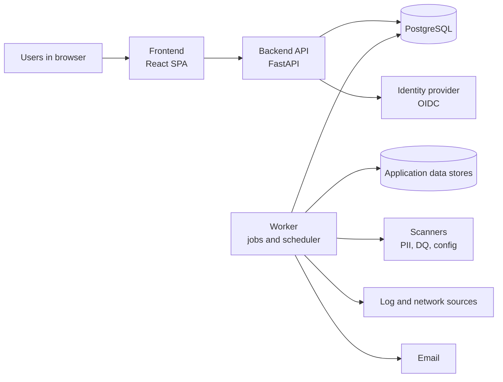
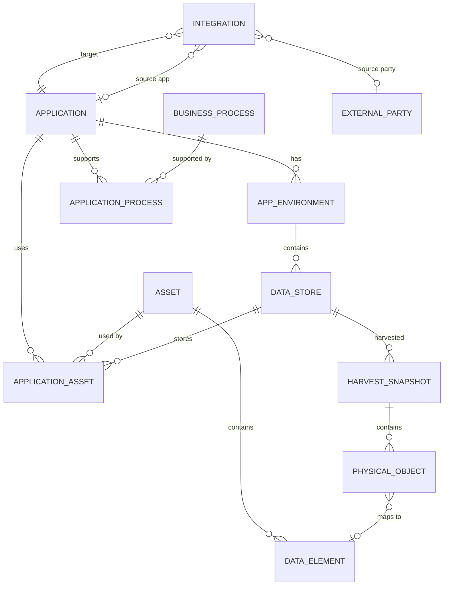

# Data Management Centre: architecture

Read with `PRD.md` (what and why) and `DESIGN.md` (how the UI looks and behaves).

## 1. Principles

- **Simple to run.** One frontend, one backend codebase, one PostgreSQL database. Background work runs in a worker process from the same codebase, using a Postgres-backed job queue, so there is no extra infrastructure.
- **Modular inside.** The backend is split into domain modules with enforced boundaries, so modules can become services later without a rewrite.
- **Facts in, results out.** Every check is a pure evaluation of recorded facts against a versioned rule, producing an append-only result.
- **Attributes, not instances.** Policies select what they apply to by attributes, so new applications inherit the right controls automatically.
- **Explainable by default.** Every derived item carries a reason and references to the facts and evidence behind it.
- **Server decides permissions.** The API returns what the user may do; the client never infers it.

## 2. System context



| Component | Responsibility |
|---|---|
| Frontend | All UI. Static build served behind the corporate gateway |
| Backend API | REST API, authorisation, validation, queries |
| Worker | Harvest, scans, flow observation, evaluations, exports, notifications, scheduled sweeps |
| PostgreSQL | System of record: inventory, policies, results, workflow, audit, job queue |
| Identity provider | SSO and group membership for roles and scopes |

## 3. Technology

| Layer | Choice |
|---|---|
| Frontend | React, TypeScript, Vite, Tailwind CSS v4, shadcn/ui, TanStack Query for server state, URL search params for view state |
| Backend | Python, FastAPI, Pydantic v2, SQLAlchemy 2, Alembic |
| Jobs | Postgres job table with `SELECT … FOR UPDATE SKIP LOCKED`; scheduler in the worker |
| Database | PostgreSQL, one schema per backend module |
| Auth | OIDC with the corporate identity provider |
| Testing | Vitest and Playwright (with axe) on the frontend; pytest on the backend |

## 4. Repository layout

```
/
├── PRD.md
├── ARCHITECTURE.md
├── DESIGN.md
├── CLAUDE.md
├── frontend/
│   ├── CLAUDE.md
│   └── src/
│       ├── components/ui/        shadcn primitives (not imported by features)
│       ├── components/patterns/  DMC patterns
│       ├── features/             screens, one folder per area
│       ├── hooks/
│       ├── lib/                  API client, formatting
│       └── styles/
└── backend/
    ├── CLAUDE.md
    ├── app/
    │   ├── main.py
    │   ├── core/                 config, db, auth, base schemas, errors
    │   └── modules/              one package per domain module
    ├── migrations/               Alembic
    └── tests/
```

The repository starts as one repo and may split into frontend and backend repositories later.

## 5. Backend modules

| Module | Owns |
|---|---|
| `identity` | Users, roles, scopes (domains), group mapping from the identity provider |
| `inventory` | Applications, environments, data stores, assets, data elements, integrations, business processes, ownership, classification, declarations, harvest snapshots |
| `connectors` | Harvest adapters per platform, scanner adapters, flow observation adapters, evidence source health |
| `policy` | Policies, controls, rules and versions, applicability selectors, applied control derivation |
| `evaluation` | Policy engine, evaluation runs, results, evidence |
| `workflow` | Actions, exceptions, access requests, change reviews, attestations, inbox items |
| `reporting` | Posture, coverage, remediation and risk read models; audit packs; digests |
| `notification` | In-app notifications, email, digests, preferences |
| `audit` | Append-only audit trail |

Rules:

- Modules call each other only through a public `service.py` interface; contracts are enforced in CI with `import-linter`.
- Each module owns its database schema; no module writes another module's tables.
- Cross-module reactions use domain events written to an outbox table in the same transaction and processed by the worker.

## 6. Data model

### 6.1 Inventory



| Table | Key fields |
|---|---|
| `application` | name, code, description, `app_owner_id`, `tech_owner_id`, `domain_id`, criticality, hosting, `vendor_id`, lifecycle_status (planned, active, retiring, decommissioned) |
| `app_environment` | `application_id`, type (production, non_production), region |
| `data_store` | `environment_id`, type, platform, region, `connection_ref` (secret reference, never the secret), harvest_status, last_harvested_at |
| `asset` | type (dataset, report, model, file), name, `owner_id`, `steward_id`, classification, classification_status, `domain_id`, `data_category_id`, business_context, is_stored, `retention_policy_id` (required when stored) |
| `data_element` | `asset_id`, name, data_type, is_pii, pii_source (scanner, declared), is_cde, dq_threshold |
| `application_asset` | `application_id`, `asset_id`, `data_store_id`, role (system_of_record, copy, consumer), access (read, write), `purpose_id` |
| `business_process` | name, `owner_id`, criticality |
| `application_process` | `application_id`, `process_id`, role (system_of_record, consumer, supporting), confirmation_status |
| `integration` | source (`source_application_id` or `source_party_id`), `target_application_id`, asset_ids, method, frequency, source_region, target_region, state (declared, observed, declared_and_observed), last_observed_at |
| `external_party` | name, region, approved_target (boolean) |
| `harvest_snapshot` | `data_store_id`, taken_at, status, error |
| `physical_object` | `snapshot_id`, kind (schema, table, column), path, row_count, oldest_record_at |
| `declaration` | subject (type, id), field, declared_value, `declared_by`, declared_at, expires_at, check_state (confirmed, mismatch, unverifiable, expired) |

Reference data: `domain`, `data_category`, `region`, `retention_policy`, `purpose`.

### 6.2 Policy and evaluation

| Table | Key fields |
|---|---|
| `policy` | name, statement, owner (governance team) |
| `control` | `policy_id`, name, description, `rule_type`, `control_owner_id`, evidence_requirement |
| `rule_version` | `control_id`, version, params (JSON), selector (JSON), created_at; immutable |
| `applied_control` | `control_id`, subject_type, subject_id, `accountable_id` (Data Owner), `responsible_id` (Application Owner), derived_from, effective_status, `latest_result_id` |
| `evidence_source` | type (config_scan, iam_export, log_sample, dq_engine, manual), `connector_ref`, schedule, health |
| `evaluation_run` | trigger (event, schedule, on_demand), started_at, finished_at, counts |
| `evaluation_result` | see 7.5; append-only |
| `evidence` | uri, sha256, captured_at, `evidence_source_id` |

### 6.3 Workflow and audit

| Table | Key fields |
|---|---|
| `action` | `applied_control_id`, title, `assignee_id`, due_at, sla, state, `verified_by_result_id` |
| `exception` | `applied_control_id`, justification, compensating_control, `approver_id`, state, expires_at |
| `access_request` | `asset_id`, `requester_id`, purpose, conditions, state, expires_at |
| `change_review` | `application_id`, change_ref, new flows, decision, `decided_by` |
| `attestation` | campaign, subject, `attester_id`, state, signed_at |
| `inbox_item` | `user_id`, kind, subject, due_at, state |
| `audit_event` | actor, action, subject, reason, before, after, at, prev_hash, hash |
| `outbox_event` | type, payload, created_at, processed_at |

### 6.4 State machines

- **Action**: open → in_progress → fixed (awaiting verification) → verified. Fixed → reopened if verification fails. Any state → cancelled with a reason.
- **Exception**: requested → approved or rejected; approved → active → expired; active → revoked.
- **Declaration check**: confirmed, mismatch, unverifiable; any → expired at `expires_at`.
- **Application lifecycle**: planned → active → retiring → decommissioned. Decommissioned requires every `application_asset` disposed of or migrated, with evidence.

## 7. Policy engine

### 7.1 Facts

Facts are recorded inventory state: harvest snapshots, declarations, scanner outputs, observed flows, DQ measurements and evidence. Every fact has a version (snapshot id or timestamp) so an evaluation can name exactly what it used.

### 7.2 Rules

- A control has a `rule_type` with a registered Python evaluator, and versioned `params` and `selector` stored as JSON.
- A selector matches subjects by attributes, for example:

```json
{ "subject": "asset", "where": { "is_stored": true, "data_category.in": ["personal", "payment"] } }
```

- An evaluator is a pure function: `(subject, facts, params) → outcome, measured, threshold, reason, fact_refs, evidence_refs`.

Initial rule types:

| Rule type | Subject | Checks |
|---|---|---|
| `retention_window` | Stored asset | Oldest record is within the retention policy |
| `dq_threshold` | CDE | Latest DQ score meets the threshold; fails when no monitor exists |
| `pii_masked_nonprod` | Data store (non-production) | PII elements are masked or tokenised |
| `pii_masked_egress` | Integration | PII to targets outside the approved list is masked |
| `cross_border_basis` | Integration | Personal or restricted data crossing regions has an approved transfer basis |
| `declaration_complete` | Application, asset | Required declarations exist and are not expired |
| `declared_vs_observed` | Integration, data store, asset | Declarations match harvested and observed facts |
| `classification_vs_pii` | Asset | Classification is consistent with PII findings |
| `harvest_fresh` | Data store | Harvest succeeded within its window |
| `encryption_at_rest` | Data store | Config scan shows encryption enabled |
| `access_review_current` | Application | Access review completed within its period |

### 7.3 Derivation

When a subject's attributes or links change, the `policy` module re-runs selectors for that subject and creates or retires applied controls. An applied control is never deleted; it is retired with a reason so history stays intact.

### 7.4 Continuous evaluation

| Trigger | When | Scope |
|---|---|---|
| Event | A fact changes (new snapshot, declaration edit, scanner result, observed flow) | Applied controls whose selectors read that fact |
| Schedule | Fixed cadence per rule type | All applied controls of that type; catches drift and refreshes freshness |
| On demand | An action is marked fixed, or a user requests re-evaluation | The action's applied controls |

- Each evaluation is keyed by `(applied_control_id, subject, fact_snapshot_hash, rule_version)`. If an identical key already has a result, nothing new is written.
- Evaluations run in the worker as jobs; failures retry with backoff and finally record an `error` outcome.
- `error` is never treated as `fail`. It routes to the evidence source owner.
- Each result sets `stale_after` from the rule's freshness window.

### 7.5 Evaluation result

| Field | Purpose |
|---|---|
| `id`, `applied_control_id`, `rule_version_id` | What ran |
| `subject_type`, `subject_id` | What was checked |
| `run_id`, `evaluated_at` | When, and in which run |
| `outcome` | pass, fail, error, not_applicable |
| `measured`, `threshold` | Where relevant |
| `reason` | Plain language; shown by "Why?" |
| `fact_refs` | Facts and versions used |
| `evidence_refs` | Evidence ids with hashes |
| `exception_id`, `effective_status` | Raw fail can be effective "excepted" |
| `previous_result_id`, `transition` | Alerts and recurrence |
| `action_id`, `verifies_action_id` | Raised action; the fix this result confirms |
| `stale_after` | Freshness |

### 7.6 Closing the loop

1. A result fails; the workflow module raises or updates an action (event via outbox).
2. The assignee marks the action fixed; it moves to "awaiting verification" and queues an on-demand evaluation.
3. A passing result sets `verifies_action_id`; the action moves to verified.
4. A failing result reopens the action.
5. A later fail after verification is recorded as recurrence.

## 8. API

- REST under `/api/v1`, JSON, OpenAPI generated by FastAPI; the frontend client is generated from it.
- Every response model inherits a shared base:

```json
{
  "data": {},
  "allowed_actions": ["edit", "create_action", "accept_risk"],
  "meta": { "evaluated_at": "2026-10-17T07:42:00Z", "stale_after": "2026-10-17T08:42:00Z" }
}
```

- Derived items include `reason`. Lists use cursor paging (`cursor`, `limit`, `next_cursor`) with server-side filter and sort.
- Errors use RFC 9457 problem details.
- Writes that may be retried accept an `Idempotency-Key` header.
- Risk decisions (accept risk, approve exception, approve access, approve transfer) require a `reason` field.
- Long operations (harvest, bulk changes, exports, audit packs) return `202` with a job id; progress via `/api/v1/jobs/{id}`.

Main resources: `applications`, `environments`, `data-stores`, `assets`, `data-elements`, `integrations`, `processes`, `declarations`, `policies`, `controls`, `applied-controls`, `results`, `evidence`, `actions`, `exceptions`, `access-requests`, `change-reviews`, `attestations`, `inbox`, `reports/*`, `search`, `jobs`, `audit`.

## 9. Security and privacy

- OIDC login; roles and scopes from identity provider groups.
- Authorisation in the service layer on every request: role permits the operation, scope permits the subject. The API computes `allowed_actions` from the same rules.
- Connector credentials live in the corporate secrets store; DMC stores only references.
- Harvest reads metadata and aggregate statistics; sampling of values is opt-in per store, masked at rest, and every reveal is logged.
- Audit events are append-only and hash-chained (`prev_hash`, `hash`) so tampering is detectable. Evidence is stored with SHA-256 hashes.

## 10. Frontend

- Screens in `src/features/<area>` import UI only from `src/components/patterns`, enforced by oxlint `no-restricted-imports`.
- Server state through TanStack Query; selection and filters in the URL so every view is deep-linkable.
- Layout: `AppShell` with `PortalHeader`; entity detail uses `EntityHeader` and `StageTracker`; list and detail through `DetailSplit`.
- Actions are rendered from `allowed_actions`.
- A `/gallery` route shows every pattern in every state and is the visual test target.

## 11. Notifications

In-app inbox items for anything awaiting a user; email digests by default; immediate email only for items due within a day or for risk decisions requested of the user.

## 12. Observability

- Structured JSON logs with request and job ids.
- Metrics: API latency, job queue depth and age, evaluation duration and error rate per rule type, harvest success per store, stale result count.
- Health endpoints for API and worker; connector health surfaced in Controls.

## 13. Quality gates

| Gate | Tool |
|---|---|
| Lint and types | oxlint (with `no-restricted-imports` boundaries), TypeScript; Ruff, mypy |
| Module boundaries | `import-linter` contracts |
| Response contract | Test that every route's response model inherits the base |
| Tests | Vitest, pytest, Playwright end-to-end |
| Accessibility | axe in Playwright on the gallery and key screens |
| Visual regression | Playwright screenshots of the gallery |
| Performance | Lighthouse CI budgets |
| Migrations | Alembic upgrade and downgrade run in CI |

## 14. Open decisions

- Regulations in scope, which set transfer boundaries and may add obligation entities.
- Trust score definition.
- Retention policy source.
- Observed-flow sources available in the estate.
- Frontend router (React Router or TanStack Router).
